**Friday 30^th^ October 2026**

Left home about 0845 and caught the train from Southampton Central to Winchester. Then I took the 67 bus from Winchester Bus station to East Meon, starting my walk at around 1115. I took 4hr 49min and walked 21.45 km (13.33 miles) along the route. I got the 65 bus back from Alresford to Winchester and the train back to Southampton, arriving home at 1820.

Visiting East Meon was inspired by there being evidence for my family on my mother's side - the Upsdales - having lived there. My Mum died on October 29^th^ 2023 aged 84, so this was the day after the third anniversary of her death. I couldn't find the Upsdale flagstone in the church, but I was able to find some records [on-line](https://www.eastmeonhistory.org.uk/google-search?st=upsdale), the oldest being a reference to Richard Upsdale in 1612.

And I went via the [Flower Pots Inn](https://www.theflowerpots.co.uk/) in Cheriton as it has previously won awards and I wanted to try the cask ale they brew there. I had a pint of the Flower Pots Bitter.

I didn't realise it before I did the walk, but this route takes in the source of the River Itchen, one of the two rivers that form the Solent estuary at Southampton.

[OS Maps East Meon to Alresford](https://explore.osmaps.com/route/33562959/east-meon-to-alresford-via-flowerpots?lat=51.04406&lon=-1.15929&zoom=11.4513&style=TopoAuto&type=2d)

[Download the GPX file](gpx/EastMeontoAlresfordviaFlowerpots.gpx){download="EastMeontoAlresfordviaFlowerpots.gpx"}

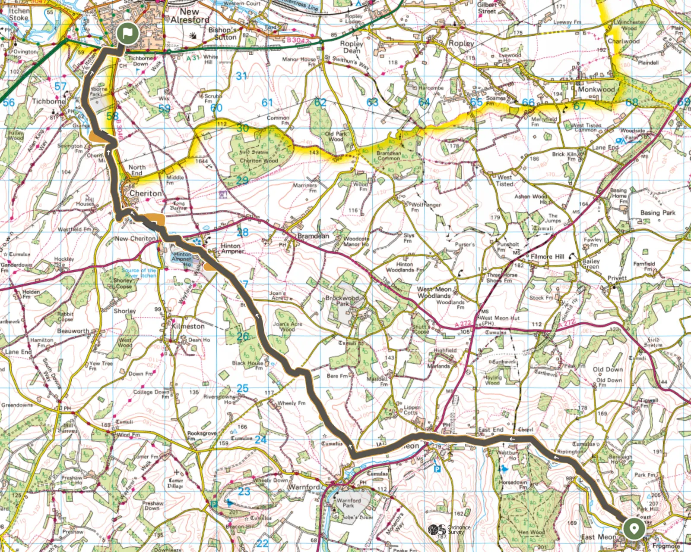{#fig-eastmeon-map fig-alt="Ordnance Survey map of the route. It starts at East Meon in the south-east, heads west past Riplington and East End to West Meon, then turns north-west past Hinton Ampner to Cheriton, and continues north past Tichborne to finish in New Alresford."}

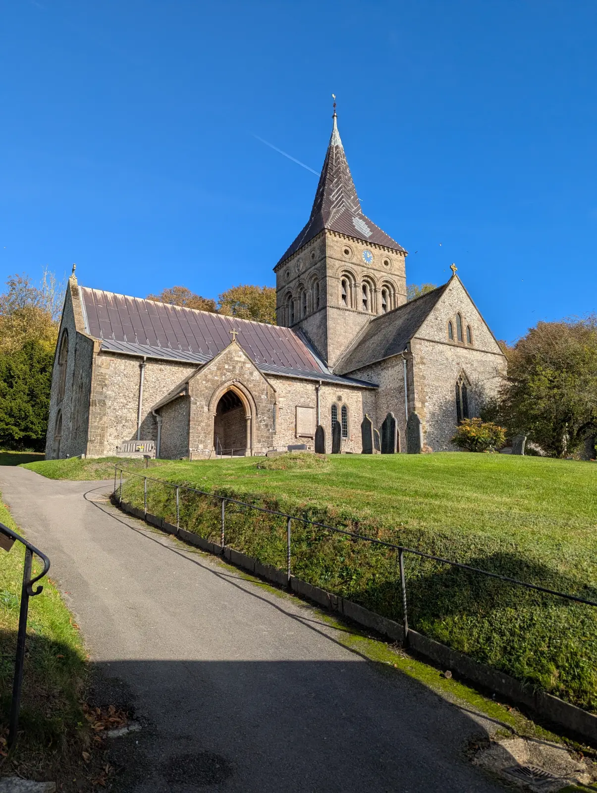{#fig-eastmeon-01 fig-alt="A flint and stone church with a squat tower and lead spire, on a grassy rise above a curving path, under a clear blue sky."}

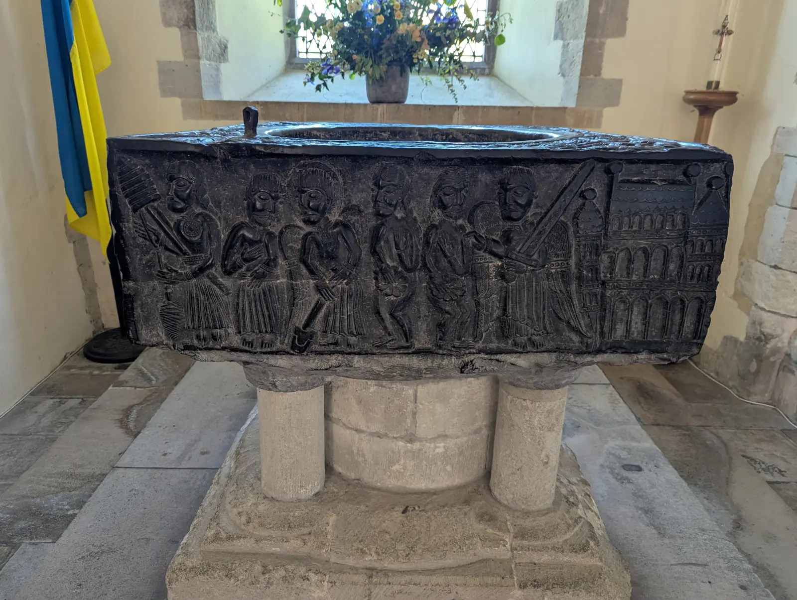{#fig-eastmeon-02 fig-alt="A dark stone font carved with a row of robed figures and an arcaded building, resting on stone columns, with flowers in a window behind."}

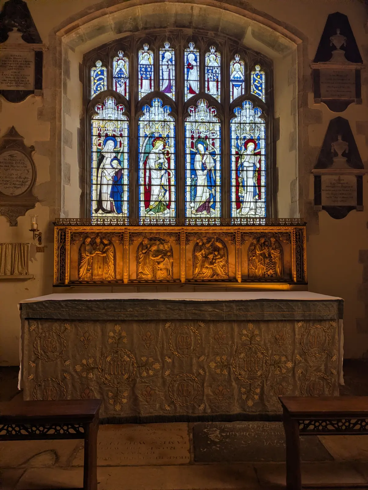{#fig-eastmeon-03 fig-alt="A stained glass window of four robed saints above a gilded carved reredos and an embroidered altar cloth, with stone memorials on the walls."}

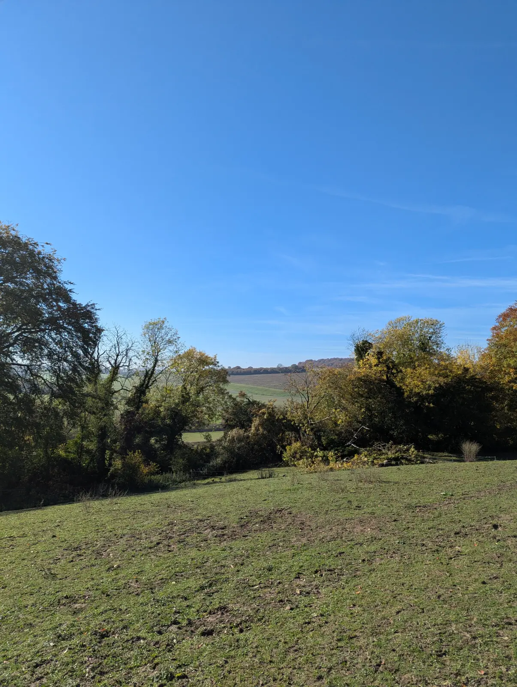{#fig-eastmeon-04 fig-alt="A grassy field leading to a line of trees in green, yellow and orange, with farmland and a wooded ridge beyond under a blue sky."}

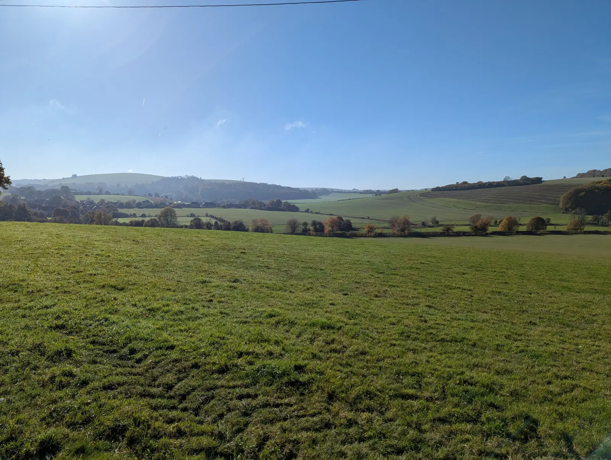{#fig-eastmeon-05 fig-alt="Wide view across green fields and hedgerows to rolling chalk hills under a hazy blue sky."}

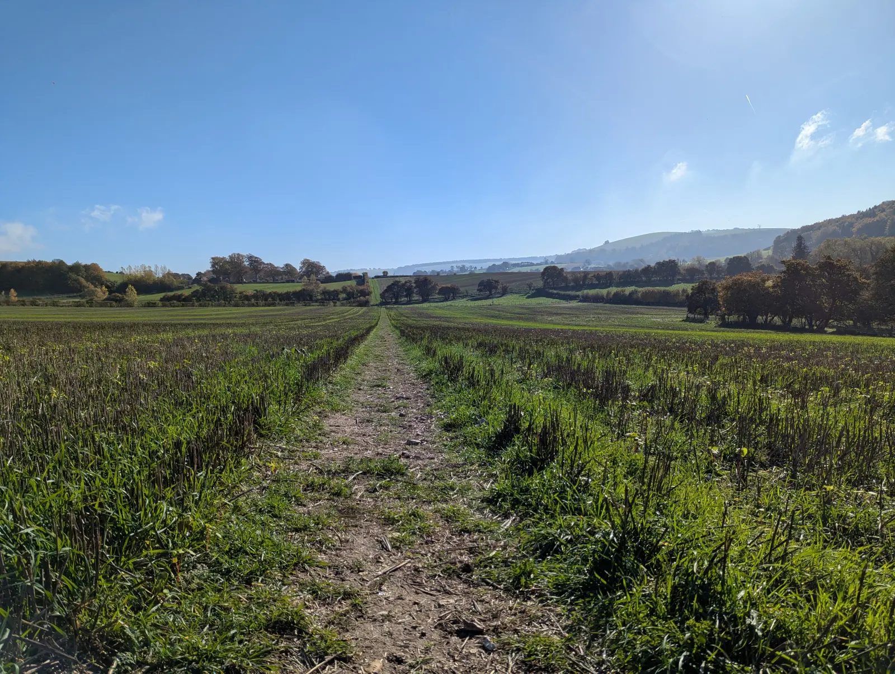{#fig-eastmeon-06 fig-alt="A narrow earth path runs straight through a field of young crops towards trees and hills in the distance."}

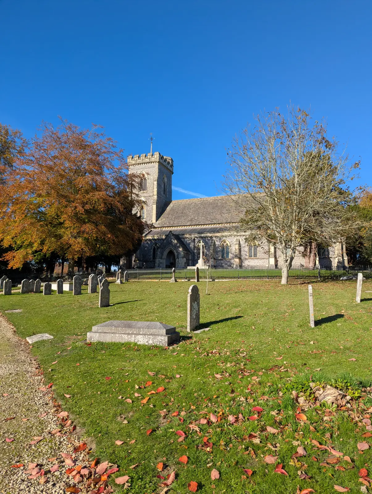{#fig-eastmeon-07 fig-alt="A stone church with a battlemented tower behind a churchyard of gravestones, with red autumn leaves on the grass and a copper beech on the left."}

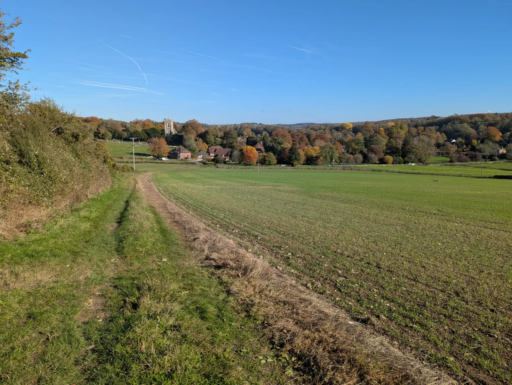{#fig-eastmeon-08 fig-alt="A grassy track beside a large green field, leading to a village among autumn trees with a church tower rising above them."}

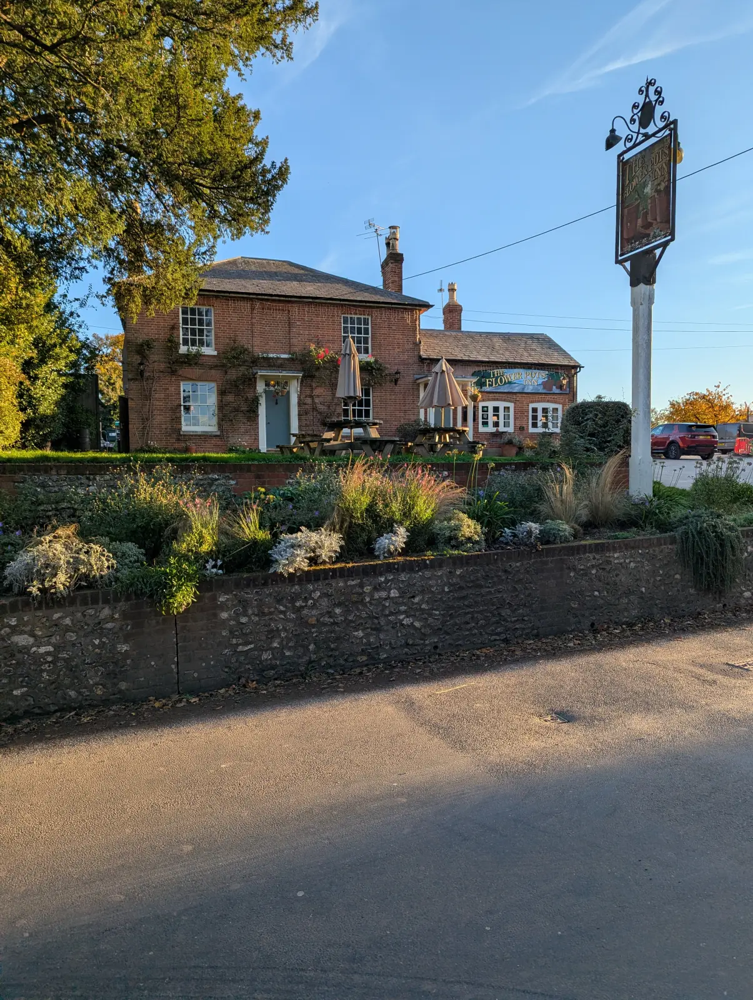{#fig-eastmeon-09 fig-alt="A red-brick pub with picnic tables and parasols in front, a hanging pub sign on a post, and a planted flint wall beside the road."}

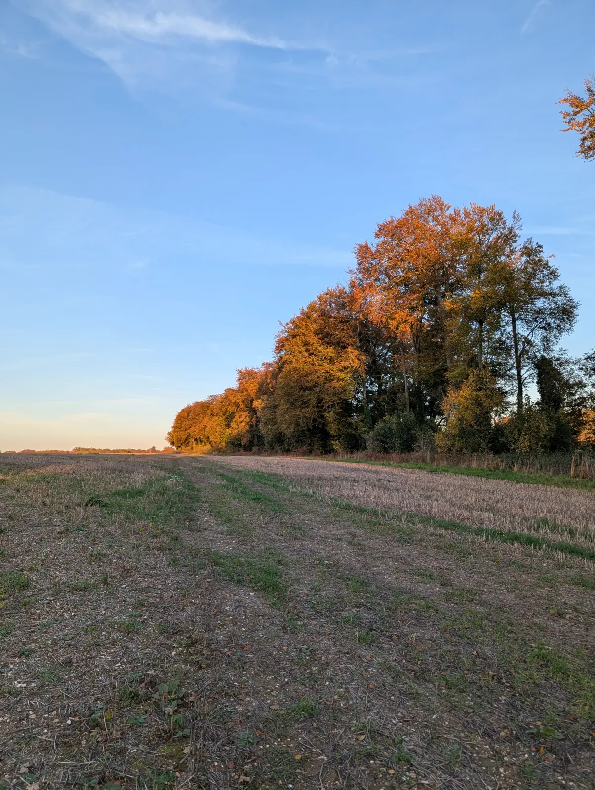{#fig-eastmeon-10 fig-alt="A line of trees glowing orange and gold in low sunlight at the edge of a stubble field, under a pale blue sky."}

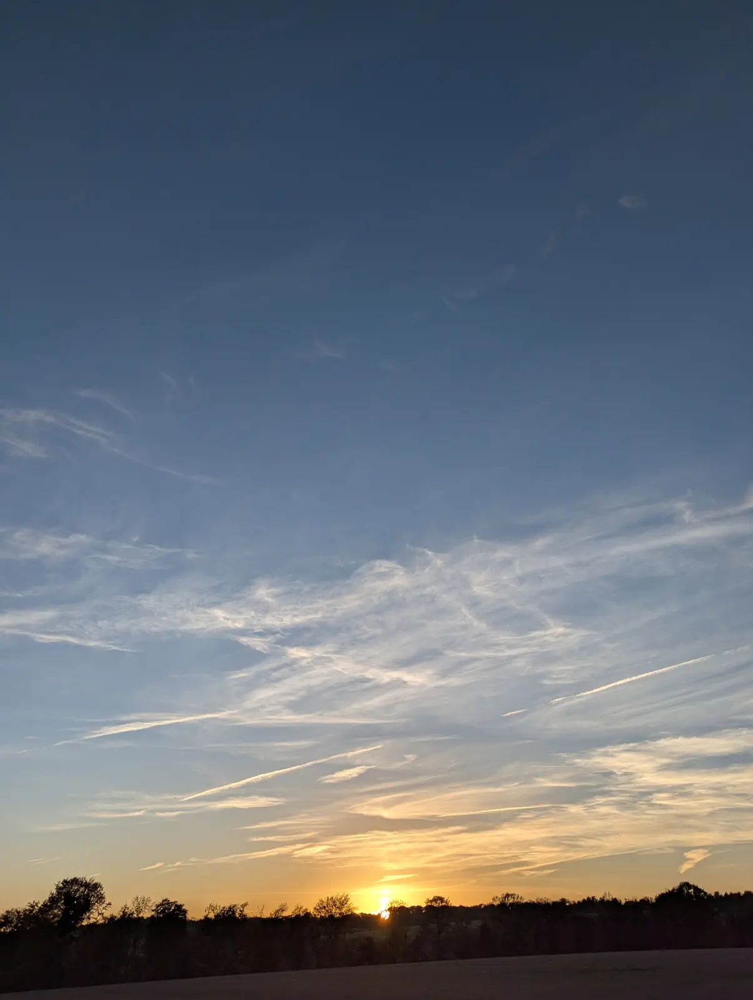{#fig-eastmeon-11 fig-alt="The sun setting behind a silhouetted line of trees, with wisps of high cloud lit gold against a deep blue sky."}

---

[← Previous: Upwey to Weymouth](../01-upwey-to-weymouth/index.qmd) · [All walks](../index.qmd) · [Next: Whitchurch to Andover →](../03-whitchurch-to-andover/index.qmd)
