*Part of my [Autumn and Winter Walks 2026/27](../index.qmd).*

**Saturday 7^th^ November 2026**

This is a Saturday Walkers Club route, [walk number 48](https://www.walkingclub.org.uk/walk/whitchurch-to-andover/).

I left home at 1010 and caught the train from Millbrook to Salisbury, and then from Salisbury to Whitchurch, starting my walk at 1215. I walked 22.32 km (13.87 miles) over 4hrs 22 minutes and then got the train home from Andover arriving home at 1845.

The route itself starts on the Test Way, the River Test being the other chalk river that forms the Solent estuary at Southampton along with the River Itchen. After Longparish, about half-way in, the route goes inland through a big wood and abandoned pig farm before coming out onto a hillside before descending into Andover.

[OS Maps Whitchurch to Andover](https://explore.osmaps.com/route/34460536/whitchurch-to-andover-walk-swcwalk?lat=51.21303&lon=-1.44862&zoom=12.1091&style=Leisure&type=2d)

[Download the GPX file](gpx/WhitchurchtoAndoverWalkSWC-Walk.gpx){download="WhitchurchtoAndoverWalkSWC-Walk.gpx"}

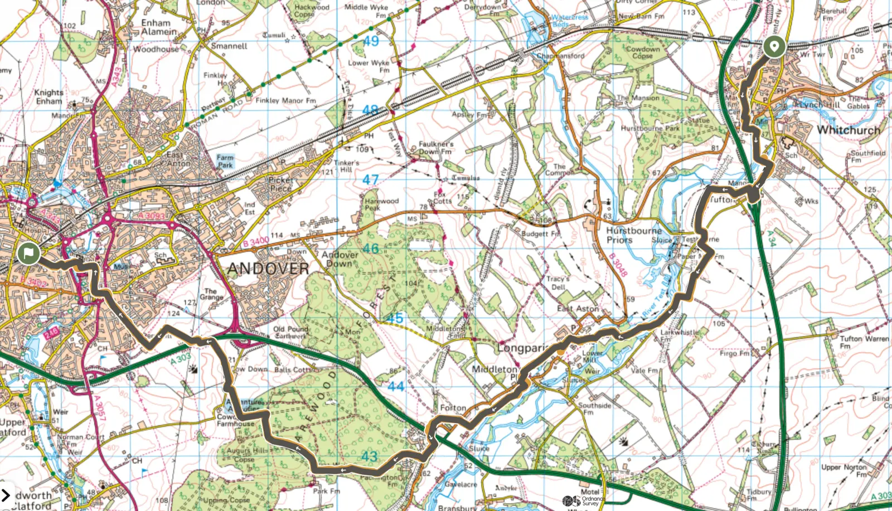{#fig-whitchurch-map fig-alt="Ordnance Survey map of the route. It starts at Whitchurch station in the north-east, follows the River Test south-west past Tufton and Testcombe to Longparish, then turns west through Harewood Forest and over Cow Down to finish in Andover."}

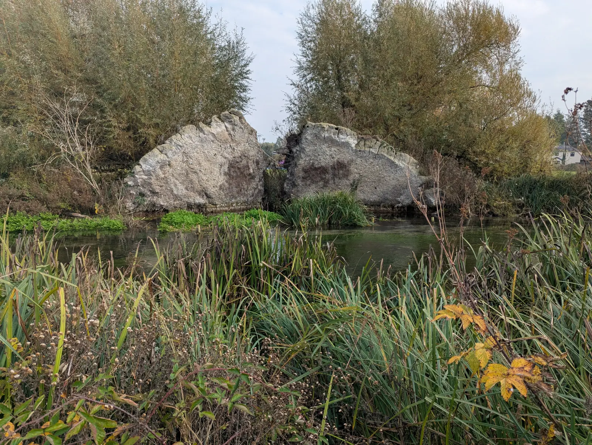{#fig-whitchurch-01 fig-alt="Two large pale boulders sitting in a still, reed-fringed stretch of river, with willows behind them and yellowing leaves in the foreground."}

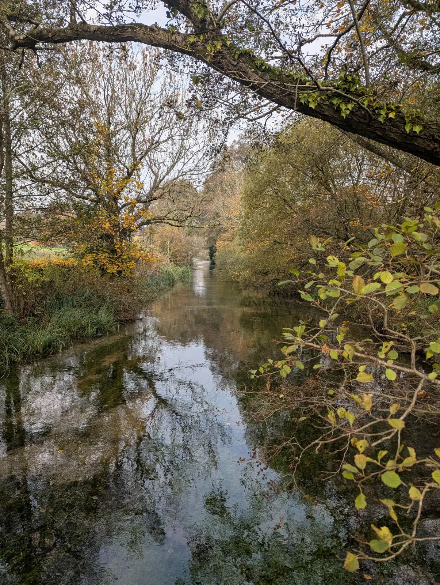{#fig-whitchurch-02 fig-alt="A calm river reflecting the sky, running away between trees and bushes in autumn colour, with a branch arching overhead."}

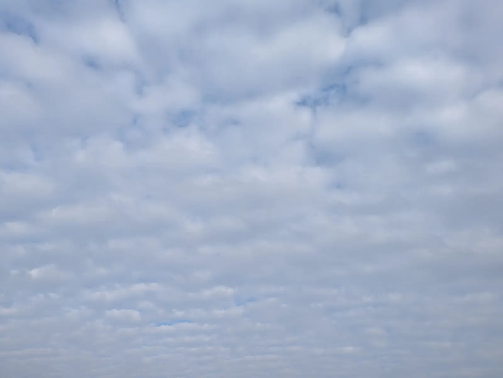{#fig-whitchurch-03 fig-alt="A sky filled with small, evenly spaced puffs of white cloud, with patches of blue between them."}

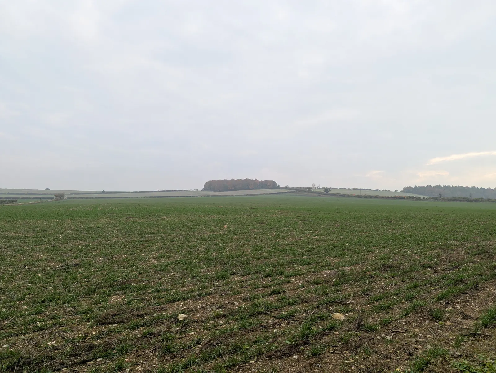{#fig-whitchurch-04 fig-alt="A wide field of young green crops under a grey sky, with a small copse on the horizon."}

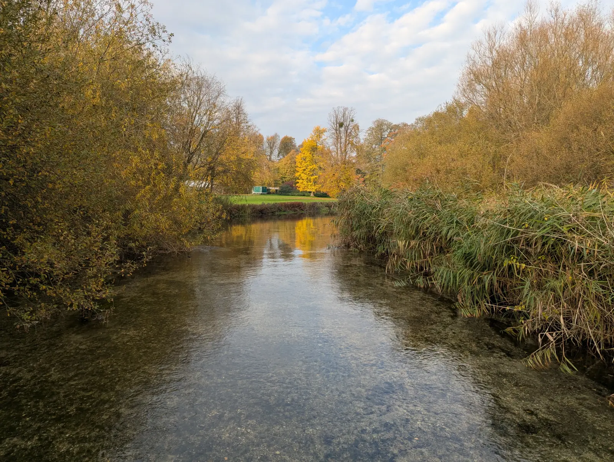{#fig-whitchurch-05 fig-alt="A shallow, very clear river with stones visible on the bed, between reeds and golden autumn trees, with a green field beyond."}

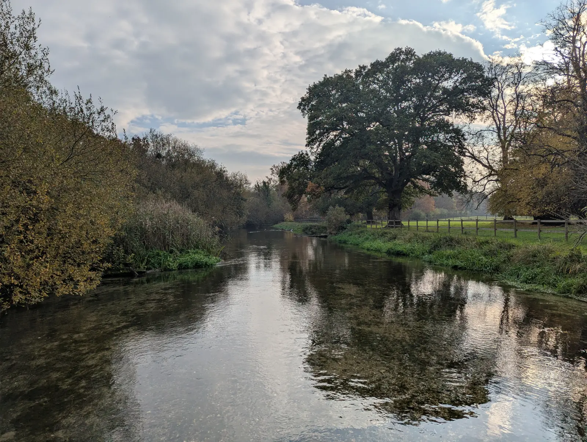{#fig-whitchurch-06 fig-alt="A broad, still river reflecting a large oak tree and the clouds above, with a fenced meadow on the right bank."}

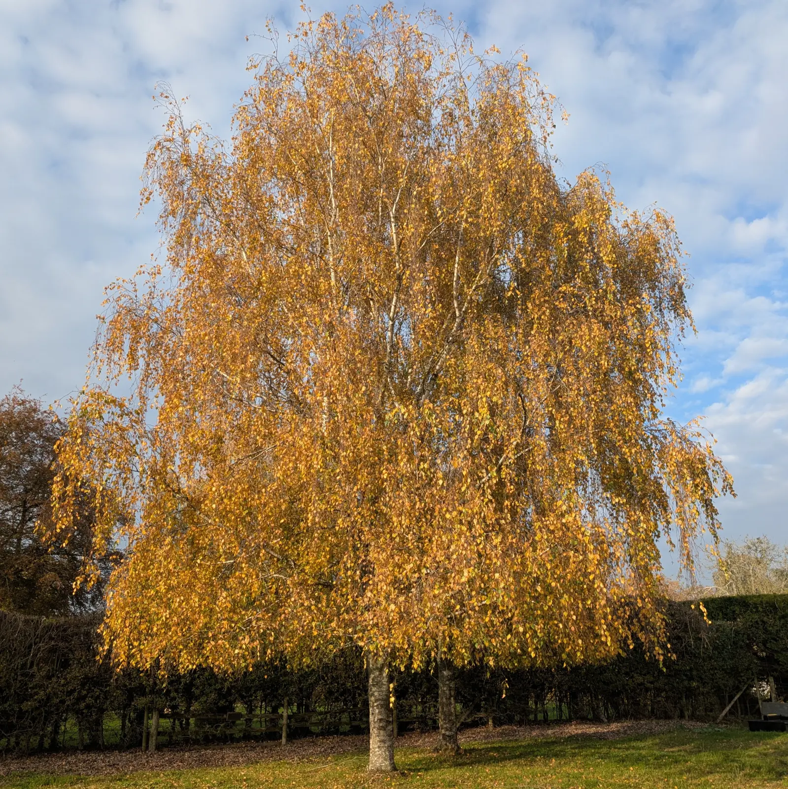{#fig-whitchurch-07 fig-alt="A silver birch with drooping branches of golden-orange leaves, standing on a lawn in front of a hedge under a blue and white sky."}

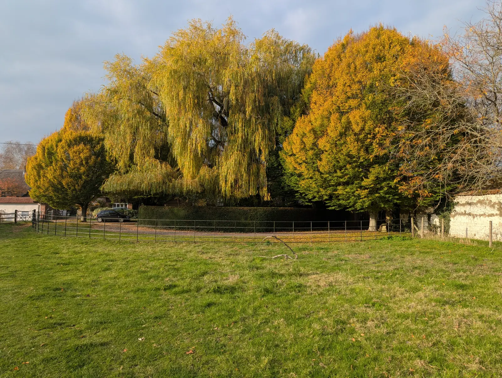{#fig-whitchurch-08 fig-alt="A green field in front of a weeping willow and trees turning yellow and orange, with a railing, a parked car and a whitewashed wall."}

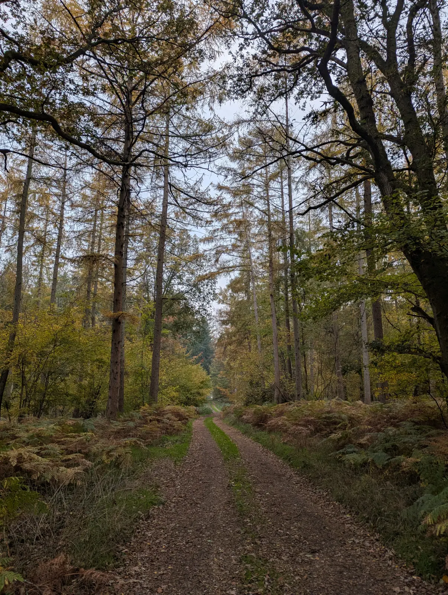{#fig-whitchurch-09 fig-alt="A leaf-covered woodland track running straight between tall larches and oaks, with bracken turning brown on either side."}

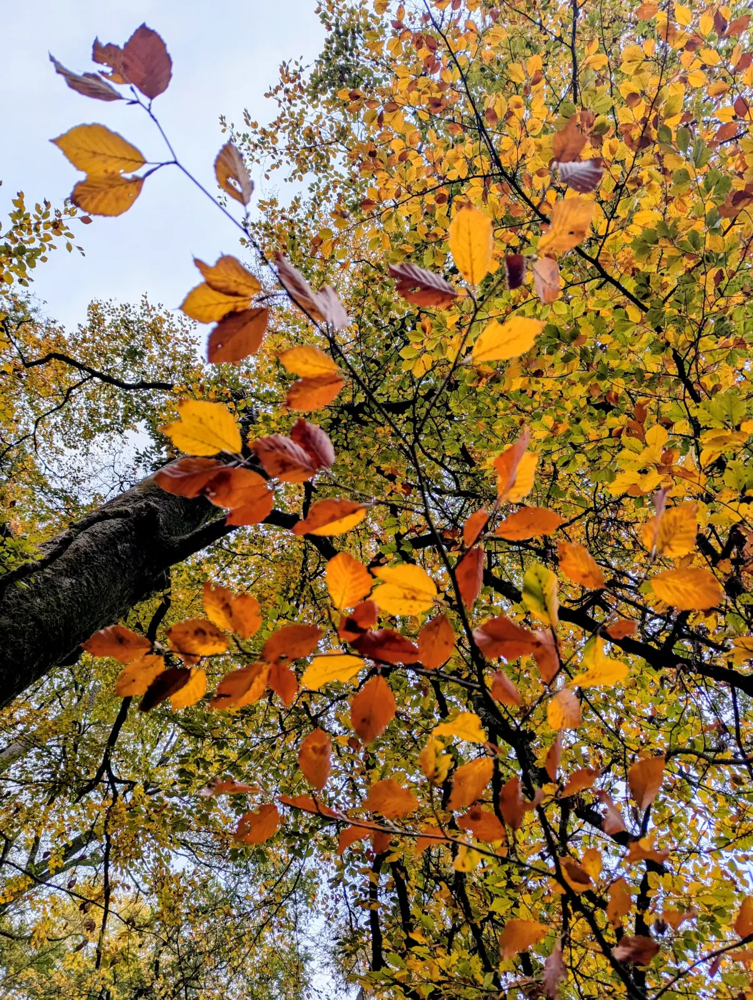{#fig-whitchurch-10 fig-alt="Looking up into a beech tree, its leaves a mix of green, yellow, orange and red against a pale sky."}

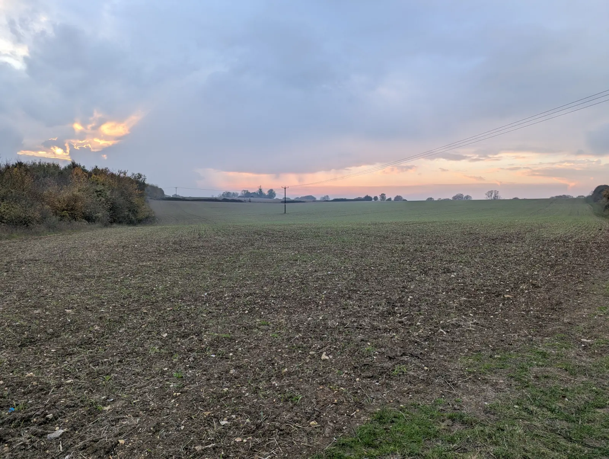{#fig-whitchurch-11 fig-alt="A large bare field under heavy cloud, with orange light breaking through near the horizon and a line of telegraph poles."}

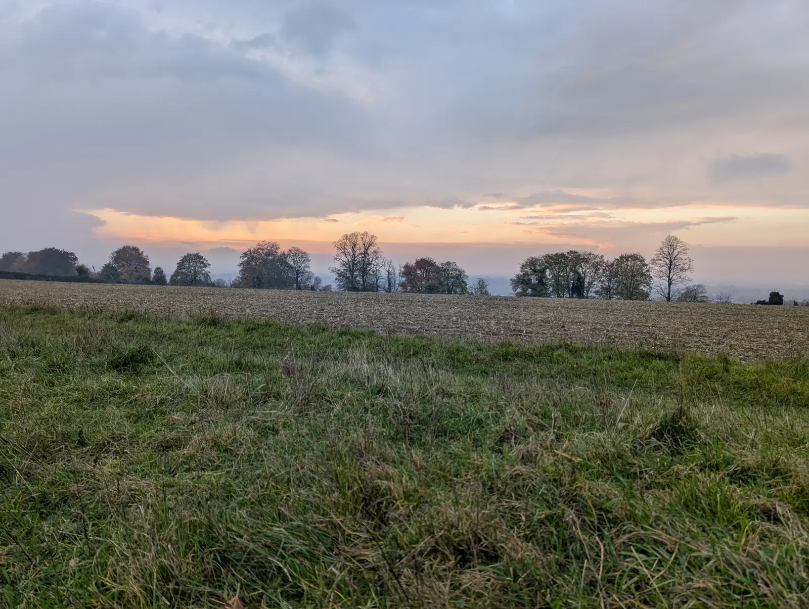{#fig-whitchurch-12 fig-alt="Rough grass and a ploughed field in the foreground, with a line of trees silhouetted against an orange band of sunset under grey cloud."}

---

[← Previous: East Meon to Alresford via The Flower Pots Inn](../02-east-meon-to-alresford/index.qmd) · [All walks](../index.qmd) · [Next: Reading Green Park to Mortimer via Burghfield →](../04-reading-green-park-to-mortimer/index.qmd)
