## Overview {#overview}

This is a brief record of day walks I did over Autumn and Winter 2026 and into Early Spring of 2027: a 25 week period between October 2026 and March 2027.

Some routes I plotted myself and others come from the [Saturday Walkers Club](https://www.walkingclub.org.uk/). The criteria are that they must be doable in a day from Southampton and using public transport.

I use [OS Maps](https://explore.osmaps.com) for planning, navigating and recording my walks. A link to each route on OS Maps I've walked is included, as well as a GPX file for download.

I've not included the distance walking to and from the train station in Southampton, but that adds about 2 km (1.2 miles) each way to my overall distance.

Click the links in the list below or in the table of contents to jump to a walk:

1.  2026-10-16 [Upwey to Weymouth](#sec-walk-01)
2.  2026-10-30 [East Meon to Alresford via The Flower Pots Inn at Cheriton](#sec-walk-02)
3.  2026-11-07 [Whitchurch to Andover](#sec-walk-03)
4.  2026-11-14 [Reading Green Park to Mortimer via Burghfield](#sec-walk-04)

## Upwey to Weymouth {#sec-walk-01}

**Friday 16^th^ October 2026**

Left home at 1040, and caught the train from Southampton Central to Upwey which is one-stop inland from Weymouth and takes about 1hr 30min. Walk to Weymouth via the ridgeway and coastal path. 17.20 km (10.69 miles) on the map, but I walked 19.29 km (11.99 miles) including a slight detour in about 4 hours and 20 minutes. Got back home at 2000.

[OS Maps Upwey to Weymouth Route](https://explore.osmaps.com/route/34160523/upwey-to-weymouth?lat=50.64118&lon=-2.45015&zoom=12.3182&style=TopoAuto&type=2d)

[Download the GPX file](gpx/UpweytoWeymouth.gpx){download="UpweytoWeymouth.gpx"}

{#fig-upwey-map fig-alt="Ordnance Survey map of the route. It starts at Upwey station, heads east along the ridgeway past Bincombe and above Osmington, drops south to the coast near Osmington Mills, then follows the coast path west past Redcliff Point and Bowleaze Cove and along Weymouth beach to the town centre."}

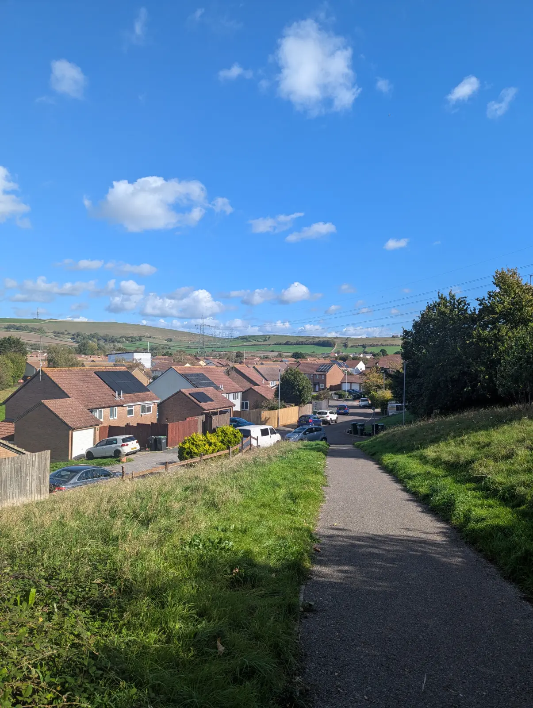{#fig-upwey-01 fig-alt="A tarmac footpath runs downhill between grassy banks towards a housing estate, with green downland beyond under a blue sky with small clouds."}

{#fig-upwey-02 fig-alt="The stone tower of a small village church beside a farmyard, with a large green forage harvester and a stack of old tyres."}

{#fig-upwey-03 fig-alt="Inside a simple whitewashed church: wooden pews, dark roof beams and hanging lamps, with a stone arch leading to the altar and a small stained glass window."}

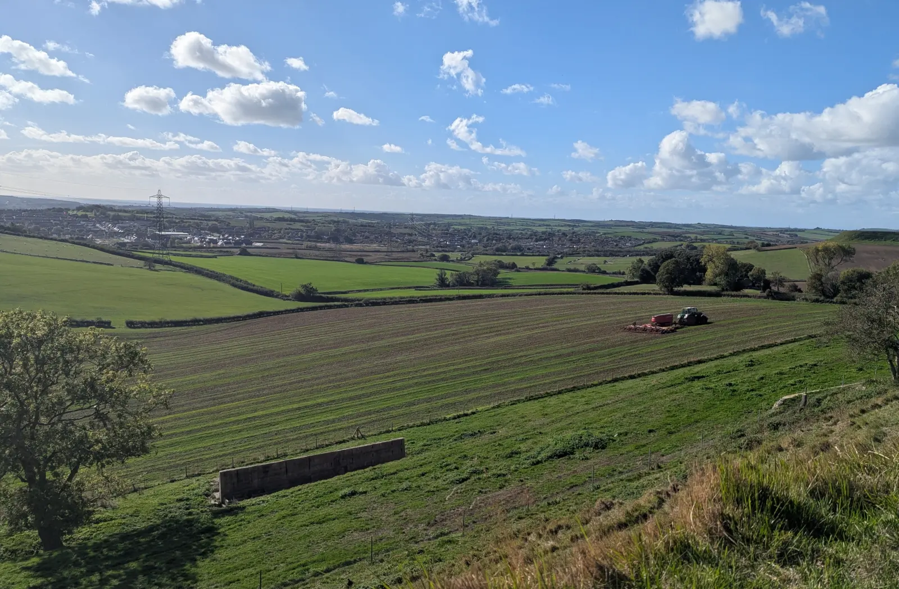{#fig-upwey-04 fig-alt="View from the ridgeway down over sloping fields, where a tractor is working a ploughed field, towards the edge of Weymouth on the horizon."}

{#fig-upwey-05 fig-alt="Looking south from the ridgeway over a patchwork of green fields and hedges to the sea, with the Isle of Portland on the horizon under a bright, cloud-dotted sky."}

{#fig-upwey-06 fig-alt="Sheep grazing on a grassy hilltop, with fields and the sea in the distance under a blue sky."}

{#fig-upwey-07 fig-alt="A quiet village lane lined with thatched stone cottages, one covered in climbing plants, with cars parked along the left-hand side."}

{#fig-upwey-08 fig-alt="A wooden fingerpost by a fence, pointing to the South Dorset Ridgeway, Osmington 1 mile, and the Coast Path, Weymouth 4½ miles."}

{#fig-upwey-09 fig-alt="Green fields slope down to a deep blue sea, with wind-bent pine trees and a low cliff along the coast."}

{#fig-upwey-10 fig-alt="The sun hidden behind a cumulus cloud, with rays fanning out around its edge, above a grassy headland and the sea."}

{#fig-upwey-11 fig-alt="Long-exposure photo of a wave washing over a golden shingle beach, the water blurred into soft white streaks."}

{#fig-upwey-12 fig-alt="An empty shingle beach curving along a calm blue sea, with low cliffs at the far end under a clear sky."}

{#fig-upwey-13 fig-alt="A group of five sea swimmers in calm water off a shingle beach in late afternoon light, with cliffs along the far side of the bay."}

{#fig-upwey-14 fig-alt="Weymouth's ornate Victorian Jubilee Clock, painted red, blue and gold, on the seafront at dusk, with terraced houses behind it."}

## East Meon to Alresford via The Flower Pots Inn {#sec-walk-02}

**Friday 30^th^ October 2026**

Left home about 0845 and caught the train from Southampton Central to Winchester. Then I took the 67 bus from Winchester Bus station to East Meon, starting my walk at around 1115. I took 4hr 49min and walked 21.45 km (13.33 miles) along the route. I got the 65 bus back from Alresford to Winchester and the train back to Southampton, arriving home at 1820.

Visiting East Meon was inspired by there being evidence for my family on my mother's side - the Upsdales - having lived there. My Mum died on October 29^th^ 2023 aged 84, so this was the day after the third anniversary of her death. I couldn't find the Upsdale flagstone in the church, but I was able to find some records [on-line](https://www.eastmeonhistory.org.uk/google-search?st=upsdale), the oldest being a reference to Richard Upsdale in 1612.

And I went via the [Flower Pots Inn](https://www.theflowerpots.co.uk/) in Cheriton as it has previously won awards and I wanted to try the cask ale they brew there. I had a pint of the Flower Pots Bitter.

I didn't realise it before I did the walk, but this route takes in the source of the River Itchen, one of the two rivers that form the Solent estuary at Southampon.

[OS Maps East Meon to Alresford](https://explore.osmaps.com/route/33562959/east-meon-to-alresford-via-flowerpots?lat=51.04406&lon=-1.15929&zoom=11.4513&style=TopoAuto&type=2d)

[Download the GPX file](gpx/EastMeontoAlresfordviaFlowerpots.gpx){download="EastMeontoAlresfordviaFlowerpots.gpx"}

{#fig-eastmeon-map fig-alt="Ordnance Survey map of the route. It starts at East Meon in the south-east, heads west past Riplington and East End to West Meon, then turns north-west past Hinton Ampner to Cheriton, and continues north past Tichborne to finish in New Alresford."}

{#fig-eastmeon-01 fig-alt="A flint and stone church with a squat tower and lead spire, on a grassy rise above a curving path, under a clear blue sky."}

{#fig-eastmeon-02 fig-alt="A dark stone font carved with a row of robed figures and an arcaded building, resting on stone columns, with flowers in a window behind."}

{#fig-eastmeon-03 fig-alt="A stained glass window of four robed saints above a gilded carved reredos and an embroidered altar cloth, with stone memorials on the walls."}

{#fig-eastmeon-04 fig-alt="A grassy field leading to a line of trees in green, yellow and orange, with farmland and a wooded ridge beyond under a blue sky."}

{#fig-eastmeon-05 fig-alt="Wide view across green fields and hedgerows to rolling chalk hills under a hazy blue sky."}

{#fig-eastmeon-06 fig-alt="A narrow earth path runs straight through a field of young crops towards trees and hills in the distance."}

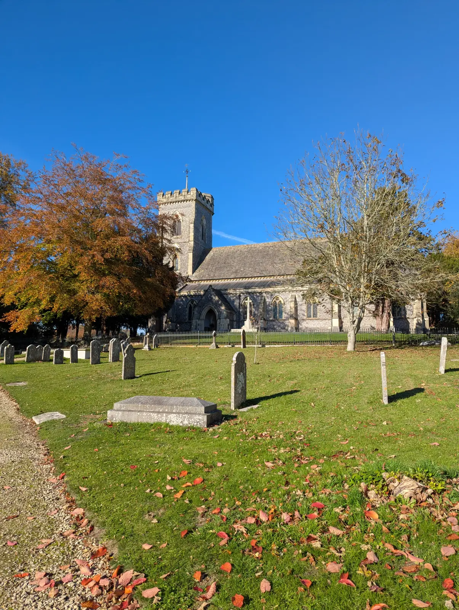{#fig-eastmeon-07 fig-alt="A stone church with a battlemented tower behind a churchyard of gravestones, with red autumn leaves on the grass and a copper beech on the left."}

{#fig-eastmeon-08 fig-alt="A grassy track beside a large green field, leading to a village among autumn trees with a church tower rising above them."}

{#fig-eastmeon-09 fig-alt="A red-brick pub with picnic tables and parasols in front, a hanging pub sign on a post, and a planted flint wall beside the road."}

{#fig-eastmeon-10 fig-alt="A line of trees glowing orange and gold in low sunlight at the edge of a stubble field, under a pale blue sky."}

{#fig-eastmeon-11 fig-alt="The sun setting behind a silhouetted line of trees, with wisps of high cloud lit gold against a deep blue sky."}

## Whitchurch to Andover {#sec-walk-03}

**Saturday 7^th^ November 2026**

This is a Saturday Walkers Club route, [walk number 48](https://www.walkingclub.org.uk/walk/whitchurch-to-andover/).

I left home at 1010 and caught the train from Millbrook to Salisbury, and then from Salisbury to Whitchurch, starting my walk at 1215. I walked 22.32 km (13.87 miles) over 4hrs 22minutes and then got the train home from Andover arriving home at 1845.

The route itself starts on the Test Way, the River Test being the other chalk river that forms the Solent estuary at Southampton along with the River Itchen. After Longparish, about half-way in, the route goes inland through a big wood and abandoned pig farm before coming out onto a hillside before descending into Andover.

[OS Maps Whitchurch to Andover](https://explore.osmaps.com/route/34460536/whitchurch-to-andover-walk-swcwalk?lat=51.21303&lon=-1.44862&zoom=12.1091&style=Leisure&type=2d)

[Download the GPX file](gpx/WhitchurchtoAndoverWalkSWC-Walk.gpx){download="WhitchurchtoAndoverWalkSWC-Walk.gpx"}

{#fig-whitchurch-map fig-alt="Ordnance Survey map of the route. It starts at Whitchurch station in the north-east, follows the River Test south-west past Tufton and Testcombe to Longparish, then turns west through Harewood Forest and over Cow Down to finish in Andover."}

{#fig-whitchurch-01 fig-alt="Two large pale boulders sitting in a still, reed-fringed stretch of river, with willows behind them and yellowing leaves in the foreground."}

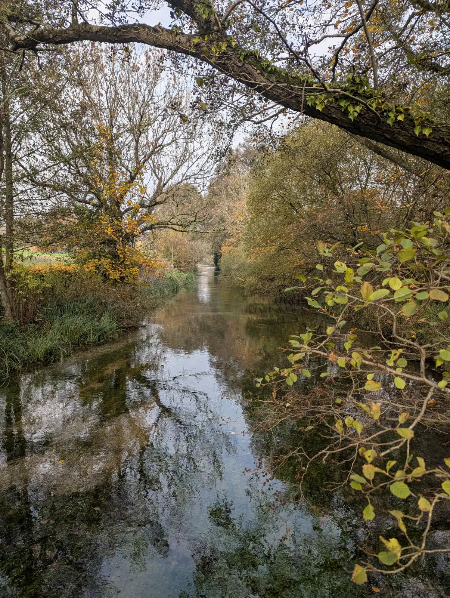{#fig-whitchurch-02 fig-alt="A calm river reflecting the sky, running away between trees and bushes in autumn colour, with a branch arching overhead."}

{#fig-whitchurch-03 fig-alt="A sky filled with small, evenly spaced puffs of white cloud, with patches of blue between them."}

{#fig-whitchurch-04 fig-alt="A wide field of young green crops under a grey sky, with a small copse on the horizon."}

{#fig-whitchurch-05 fig-alt="A shallow, very clear river with stones visible on the bed, between reeds and golden autumn trees, with a green field beyond."}

{#fig-whitchurch-06 fig-alt="A broad, still river reflecting a large oak tree and the clouds above, with a fenced meadow on the right bank."}

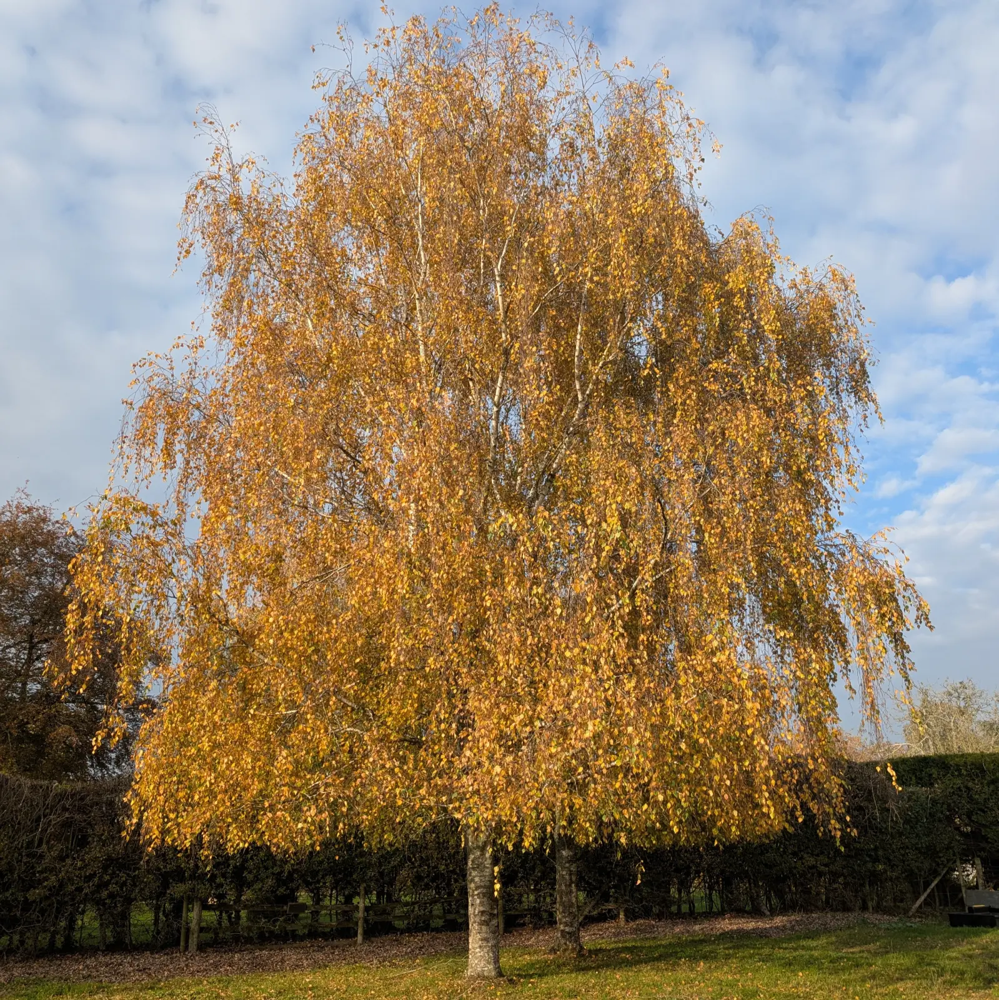{#fig-whitchurch-07 fig-alt="A silver birch with drooping branches of golden-orange leaves, standing on a lawn in front of a hedge under a blue and white sky."}

{#fig-whitchurch-08 fig-alt="A green field in front of a weeping willow and trees turning yellow and orange, with a railing, a parked car and a whitewashed wall."}

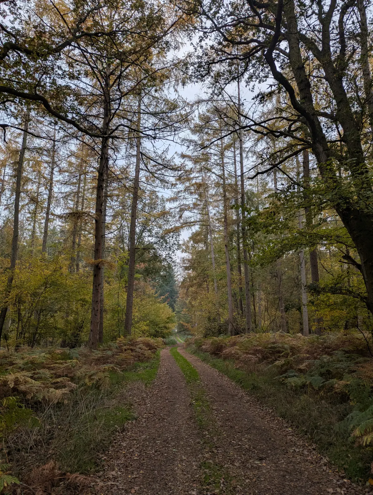{#fig-whitchurch-09 fig-alt="A leaf-covered woodland track running straight between tall larches and oaks, with bracken turning brown on either side."}

{#fig-whitchurch-10 fig-alt="Looking up into a beech tree, its leaves a mix of green, yellow, orange and red against a pale sky."}

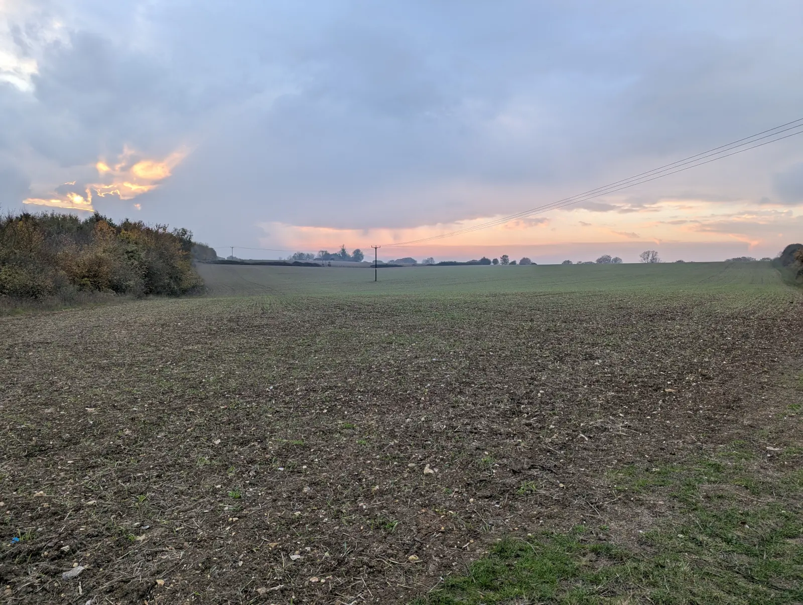{#fig-whitchurch-11 fig-alt="A large bare field under heavy cloud, with orange light breaking through near the horizon and a line of telegraph poles."}

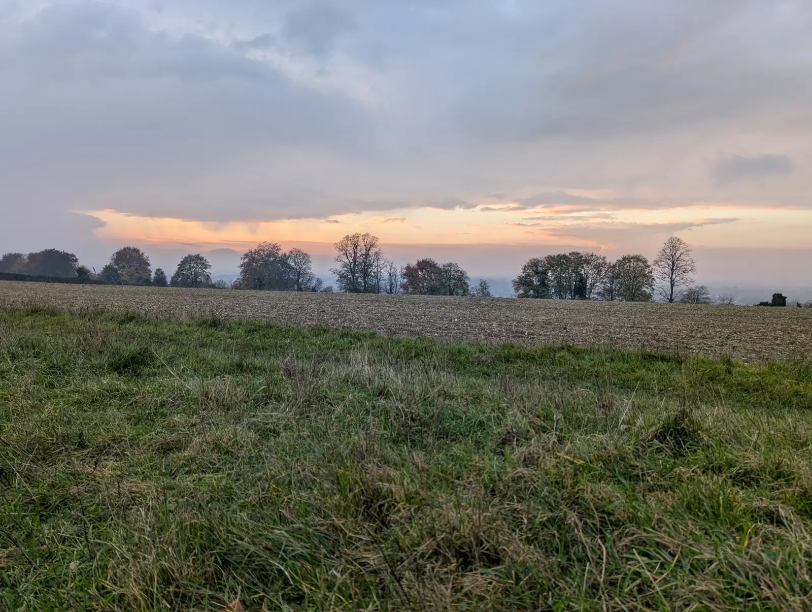{#fig-whitchurch-12 fig-alt="Rough grass and a ploughed field in the foreground, with a line of trees silhouetted against an orange band of sunset under grey cloud."}

## Reading Green Park to Mortimer via Burghfield {#sec-walk-04}

**Saturday 14^th^ November 2026**

Another personal walk. This one taking in [Burghfield](https://www.berkshirehistory.gowerweb.co.uk/villages/burghfield.html), where I lived until I was eight years old and the first school I attended. I also visited the Saint Mary's Church where my father was Rector from 1972 until 1981. My Mum's parents are buried in the churchyard there. And I walked past the house we used to live in.

I left home at 0830 and got the train from Southampton Central to Reading Green Park via Basingstoke. Reading Green Park Station didn't exist when I was a child and is another great example of UK infrastructure planning and construction. Building was originally supposed to begin in 2009 and be completed in 2010. Of course it actually opened in 2023, a mere 13 years late. The station serves a business park and residential development on the southwestern outskirts of Reading, which all still feels very new.

I had a coffee at [Esquires](https://maps.app.goo.gl/SAZiHNQ63cyLfvTo6) near the station before starting my walk at 1040. The route I plotted went along the Kennet and Avon Canal before crossing under the M4 motorway. After a rather tedious 20 minutes or so walking next to the M4 and 500 metres along a quiet, but fast road with no pavement, the route turns towards Burghfield Village. I ate my lunch in the recreation ground near the school before visiting the church.

[St Mary's Burghfield](https://www.achurchnearyou.com/church/287/page/82731/view/) contains a 14^th^ century effigy of Sir Roger de Burghfield that was stolen in 1978 and eventually returned in 1982 after it was discovered in Belgium. I have vague memories of my Dad appearing on the TV programme Nationwide around the time it was stolen. Much of the church is the same, but they've built a new modern Annexe that is bigger than the original church. I documented my visit in the prayer book and lit a candle for my Dad. He died on the 25^th^ of April 2026 aged 89.

I walked across the fields and was surprised to discover the hill we used to walk down to school is still as scary as I remember it being when I was 5. People still drive really fast and the pavement is narrow. I walked past our first house and peeked down the driveway, but didn't get too close. The final part of the walk goes through a wood I think I used to play in and down to Mortimer. I came out by the playground where I remember my Dad taking me because I got my fingers stuck between the wooden slats on the roundabout one time. Then it's about 15 minutes down to Mortimer station and I caught the 1520 train back to Basingstoke.

I walked 19.5 km (12.12 miles) over 4.5 hours and got home at 1700.

[OS Maps Reading Green Park to Mortimer](https://explore.osmaps.com/route/34513707/reading-green-park-to-mortimer-17k?lat=51.40752&lon=-1.07162&zoom=11.8860&style=Leisure&type=2d)

[Download the GPX file](gpx/ReadingGreenParktoMortimer17k.gpx){download="ReadingGreenParktoMortimer17k.gpx"}

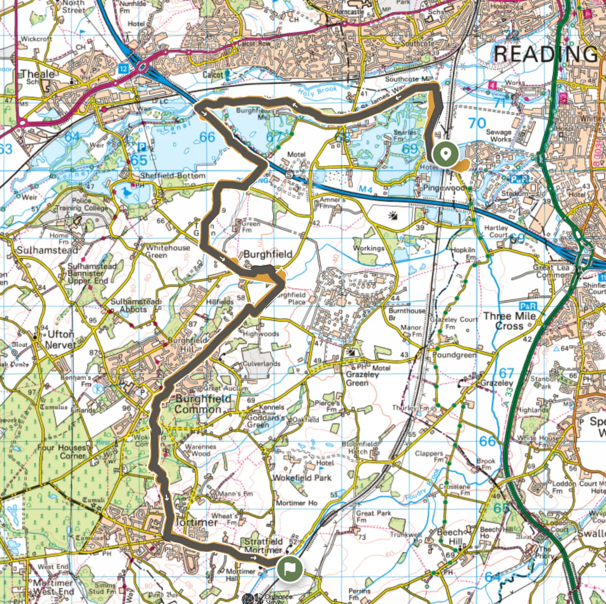{#fig-burghfield-map fig-alt="Ordnance Survey map of the route. It starts at Reading Green Park station near Pingewood, heads north to Southcote Mill, then west along the Holy Brook and Kennet and Avon Canal past Burghfield Mill and the lakes. It turns south under the M4 to Burghfield village, then south-west up Burghfield Hill, through Burghfield Common and the woods beyond, and finishes at Mortimer station in Stratfield Mortimer."}

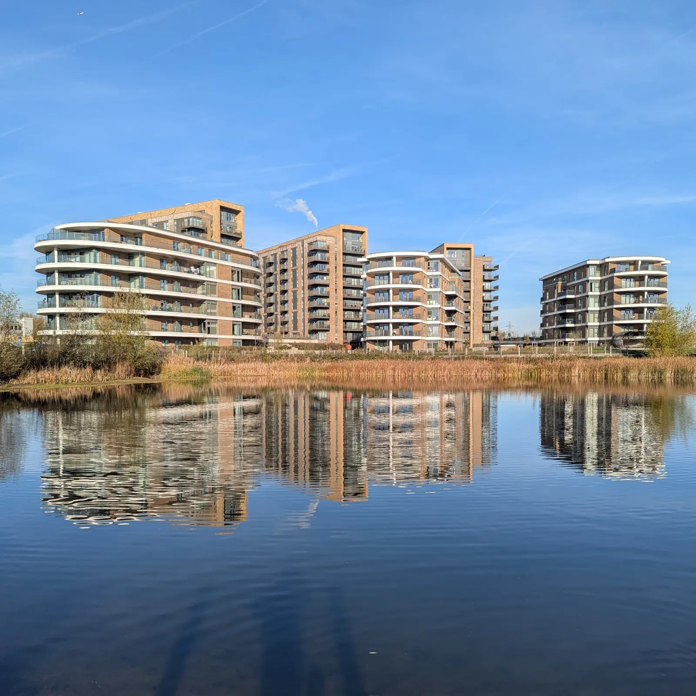{#fig-burghfield-01 fig-alt="Modern curved apartment blocks with balconies stand behind reeds on the far side of a still lake, reflected in the water under a clear blue sky."}

{#fig-burghfield-02 fig-alt="A large, many-stemmed willow with bare yellow-brown branches against a blue sky, standing among long grass and reeds."}

{#fig-burghfield-03 fig-alt="A narrow trodden path through frosty long grass, leading towards trees and bushes under a bright blue sky, with bare branches overhanging the top of the frame."}

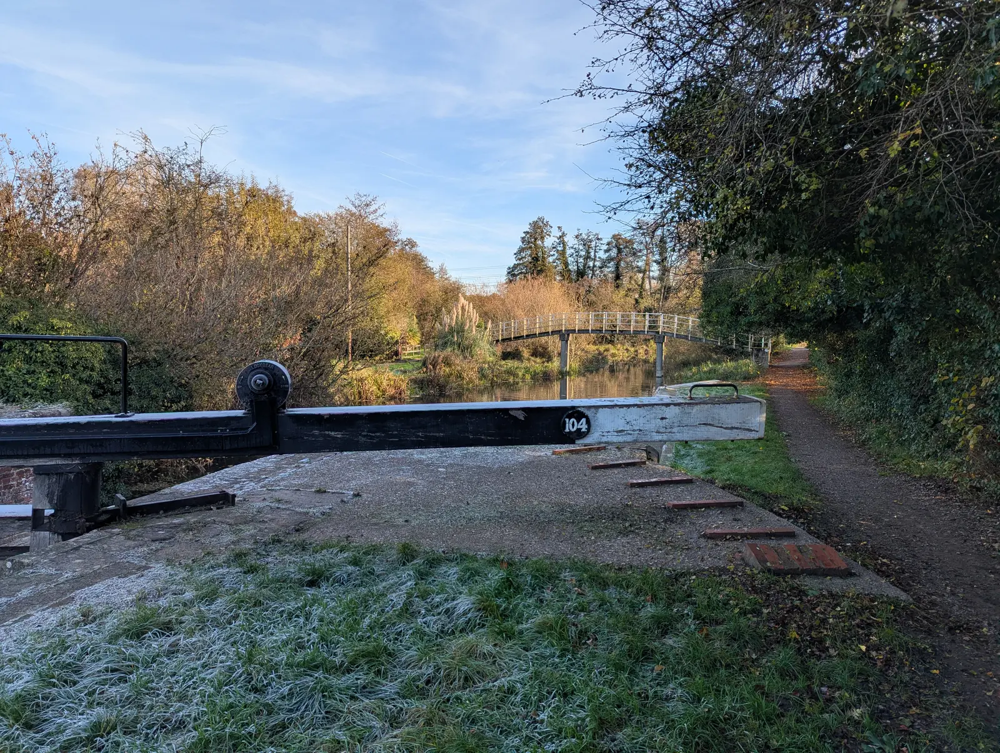{#fig-burghfield-04 fig-alt="The black and white balance beam of a canal lock gate numbered 104, with frost on the grass in front and a towpath and footbridge beyond among autumn trees."}

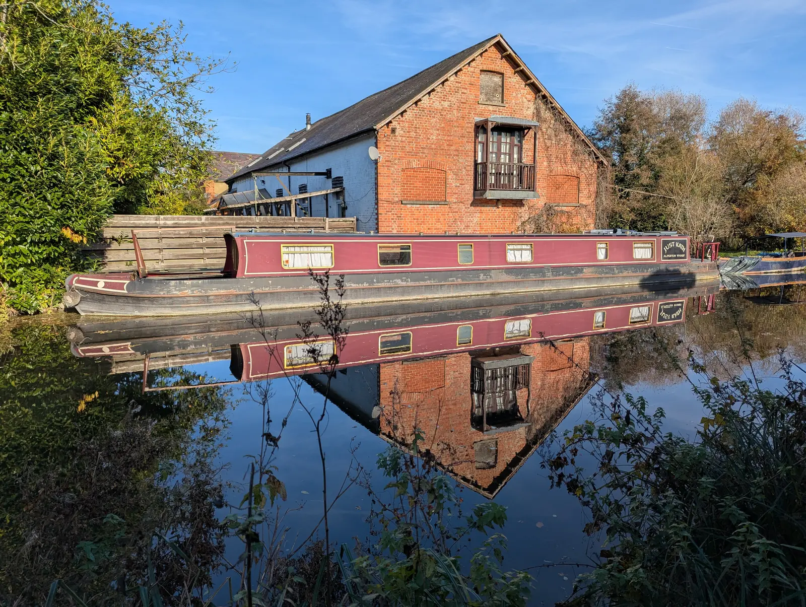{#fig-burghfield-05 fig-alt="A maroon narrowboat moored in front of a tall red-brick building with a gabled roof and balcony, both mirrored perfectly in the still water of the canal."}

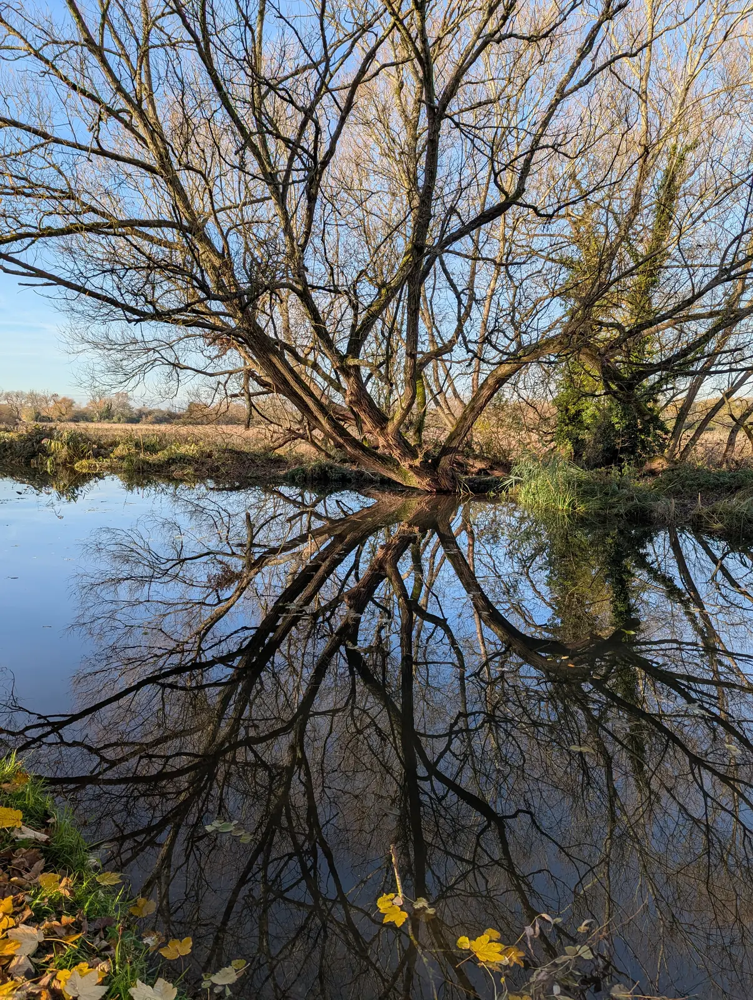{#fig-burghfield-06 fig-alt="A spreading bare willow leaning out over calm water, its branches and their mirror image forming a symmetrical pattern, with yellow leaves in the foreground."}

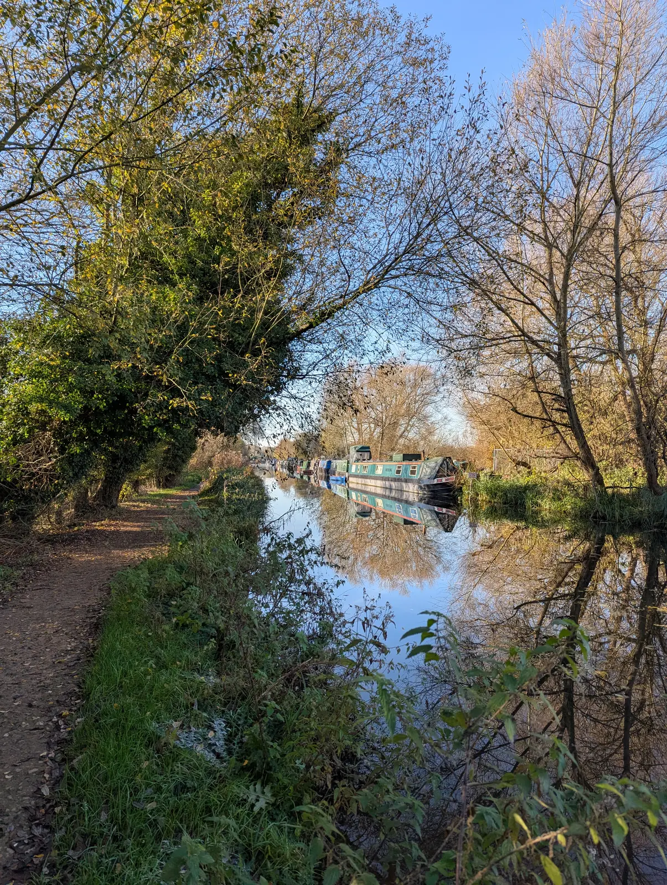{#fig-burghfield-07 fig-alt="A grassy towpath runs beside the canal, with a line of moored narrowboats in the distance and trees in green and gold reflected in the water."}

{#fig-burghfield-08 fig-alt="A faint path runs across rough, pale grassland towards a line of trees, under a deep blue sky crossed by a single long vapour trail."}

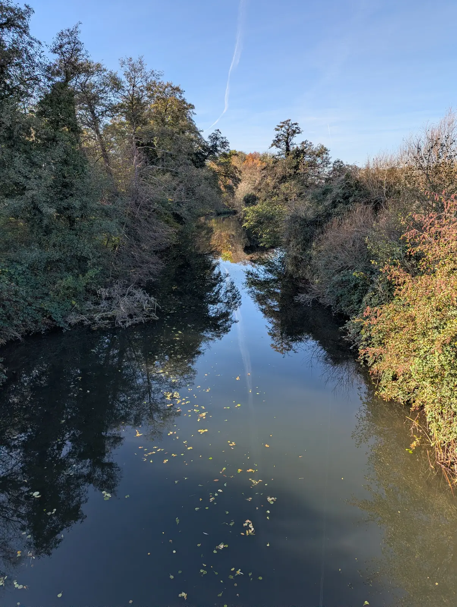{#fig-burghfield-09 fig-alt="A straight, dark stretch of water between banks of trees and bushes in green, orange and gold, with fallen leaves floating on the surface."}

{#fig-burghfield-10 fig-alt="Long-exposure photo looking up a scrubby bank to the motorway, where passing traffic is blurred into streaks beneath the back of a large road sign."}

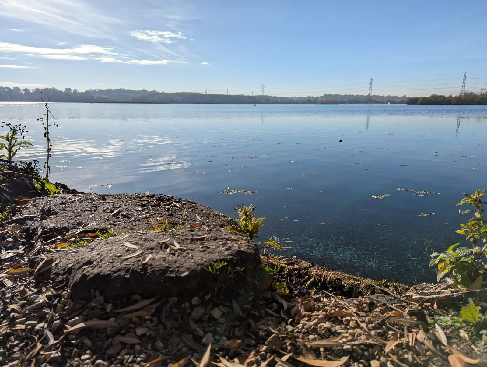{#fig-burghfield-11 fig-alt="A wide, calm lake under a pale blue sky, with a flat rock and fallen leaves on the near shore and a line of trees and electricity pylons on the far side."}

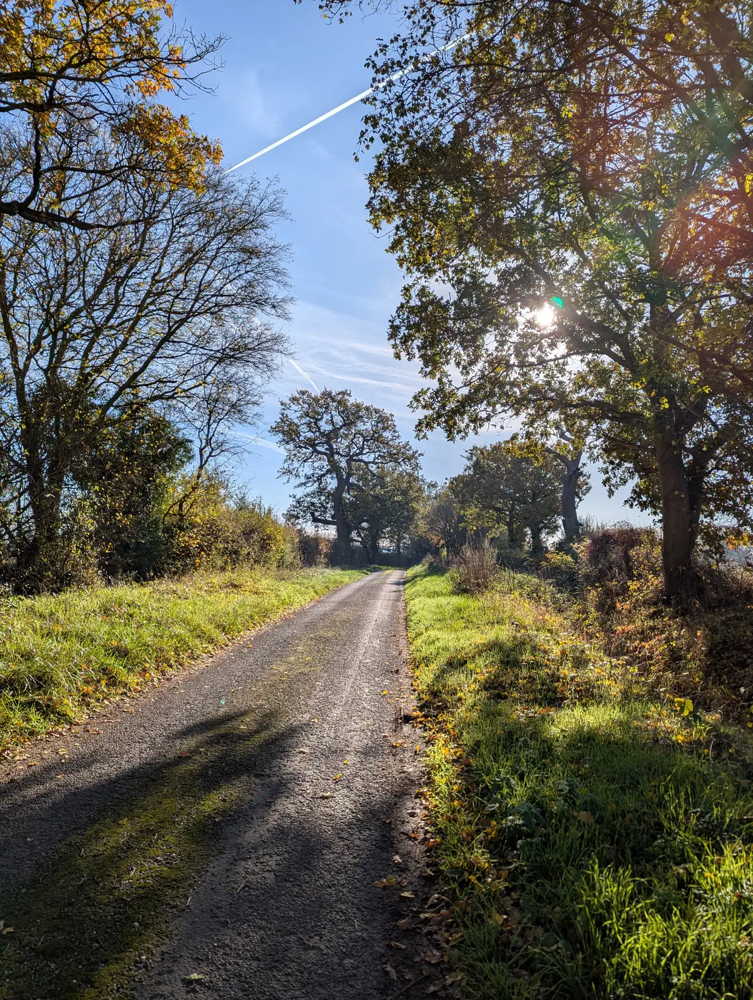{#fig-burghfield-12 fig-alt="A narrow tarmac lane runs between grass verges and tall oak trees, with the sun shining through the branches on the right and a vapour trail in the sky."}

{#fig-burghfield-13 fig-alt="A broad field of young green crops stretching to a line of scattered trees on the horizon, under a blue sky criss-crossed with vapour trails."}

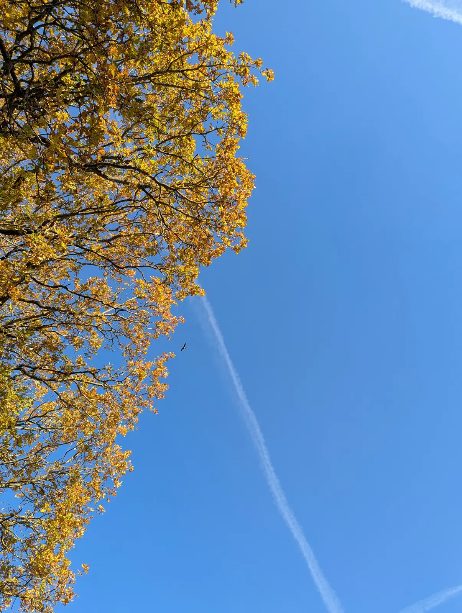{#fig-burghfield-14 fig-alt="Looking up at an oak with bright yellow autumn leaves on the left, against a clear blue sky with a vapour trail running diagonally across it and a red kite, a tiny dark silhouette, gliding beside the trail."}

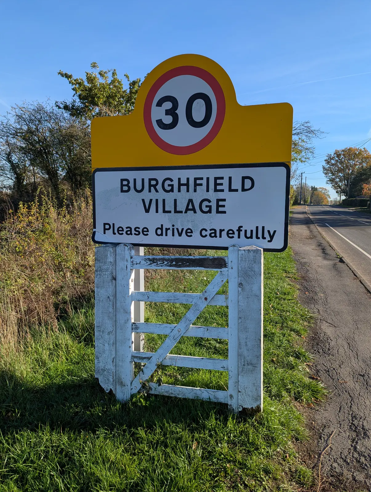{#fig-burghfield-15 fig-alt="A roadside village sign reading 30, Burghfield Village, Please drive carefully, mounted above a white wooden gate on a grass verge beside the road."}

{#fig-burghfield-16 fig-alt="A Victorian red-brick school building with a clock tower and steep gables, behind green railings hung with colourful banners, under a blue sky."}

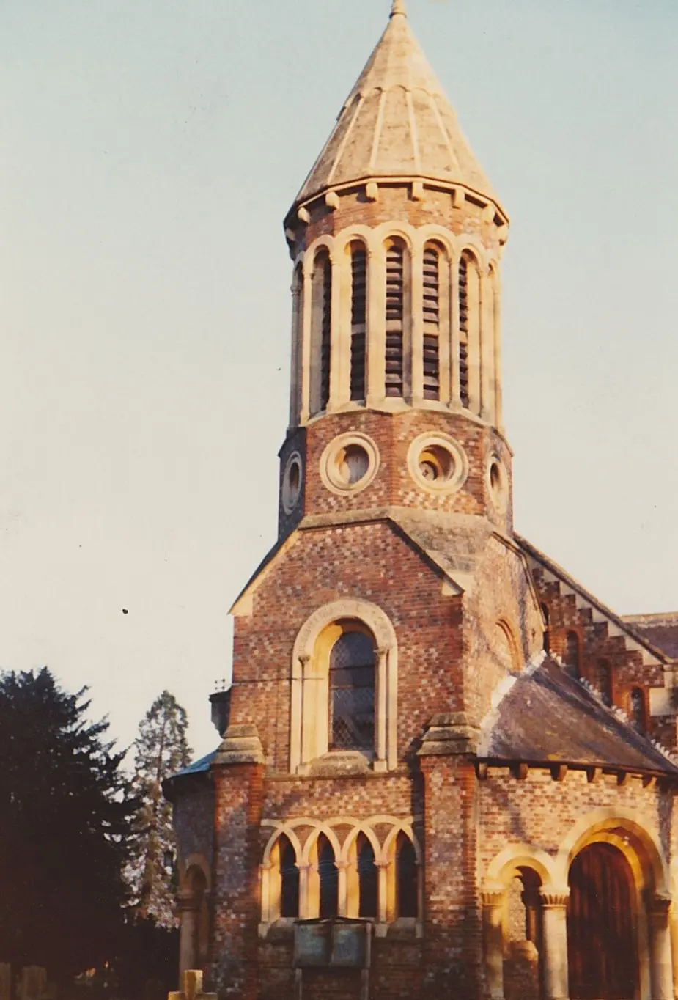{#fig-burghfield-17 fig-alt="A faded colour photograph of a brick and stone church tower with arched openings, round windows and a pointed stone spire, lit by low sun."}

{#fig-burghfield-18 fig-alt="A Victorian church of red and grey brick with a tall tower topped by an open belfry and pointed spire, behind a churchyard of gravestones under a blue sky with white clouds."}

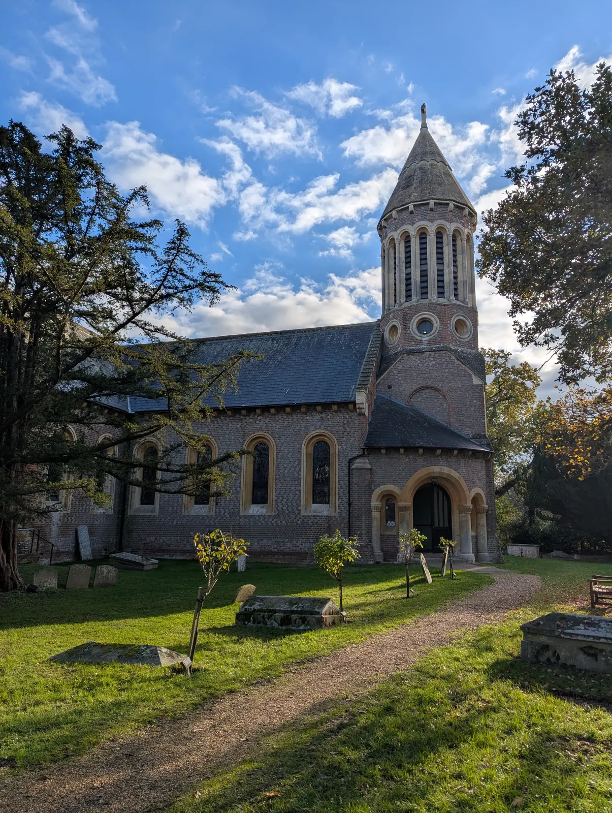{#fig-burghfield-19 fig-alt="A gravel path curves across the grassy churchyard to the arched entrance of the church, seen from the side with its tower on the right and a dark yew tree on the left."}

{#fig-burghfield-20 fig-alt="A dark timber lychgate with a steep, carved roof over a gravel path, with red knitted poppies tied to its posts, framed by trees."}

{#fig-burghfield-21 fig-alt="View through the timber lychgate from the other side, with a large red poppy hanging under the roof and a stone war memorial surrounded by poppies beyond."}

{#fig-burghfield-22 fig-alt="A faded colour photograph of a family in summer clothes gathered around a dark headstone in long grass: a man standing on the left, a woman holding a toddler, and a boy crouching in front."}

{#fig-burghfield-23 fig-alt="A round-topped slate headstone with a carved cross, inscribed david william upsdale 1907 to 1978 and his wife kathleen ella 1905 to 1958, standing in grass with fallen leaves."}

{#fig-burghfield-24 fig-alt="The nave of the church with a dark timber roof, pale tiled floor and rows of wooden chairs, looking towards a pointed arch and a carved altar screen, with stained glass windows on either side."}

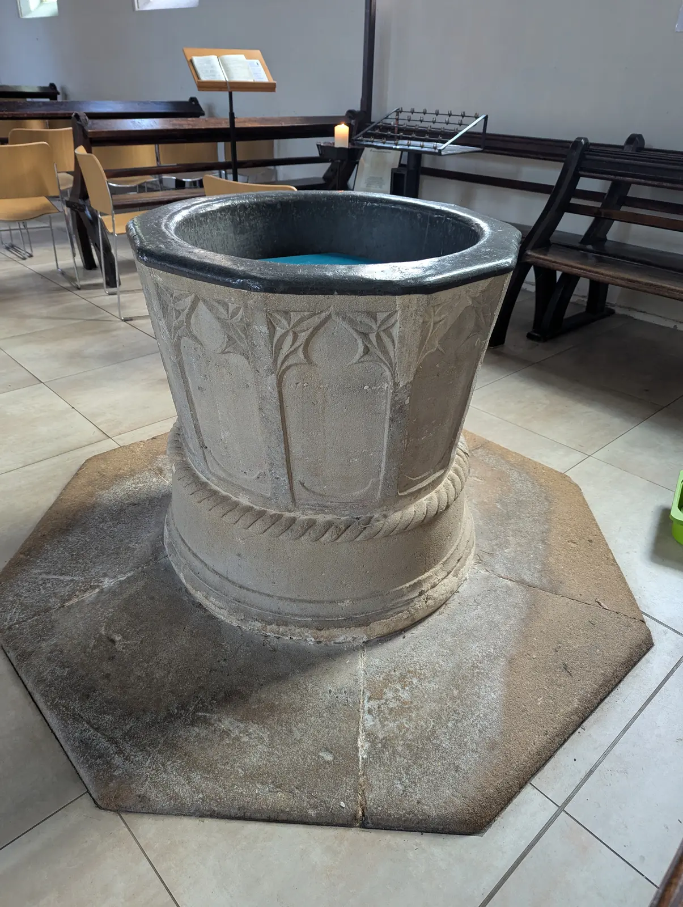{#fig-burghfield-25 fig-alt="A carved stone font on an octagonal stone base, with pointed arch decoration on its bowl, standing on a tiled floor among pews."}

{#fig-burghfield-26 fig-alt="A worn wooden effigy of a knight lying in a long glass case with a wooden frame, on a black and white chequered floor beneath a stone arch with an information notice."}

{#fig-burghfield-27 fig-alt="An embroidered church banner reading St Mary the Virgin Burghfield, showing Mary holding the infant Jesus between white lilies, hanging in front of dark carved panelling, with the effigy's glass case on the left."}

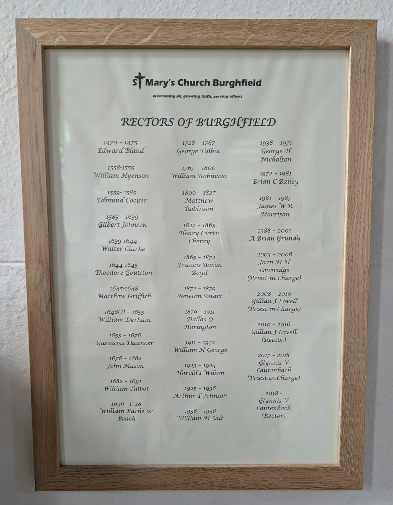{#fig-burghfield-28 fig-alt="A framed printed list headed St Mary's Church Burghfield, Rectors of Burghfield, in three columns of names and dates from 1470 to the present, including Brian C Bailey, 1972 to 1981."}

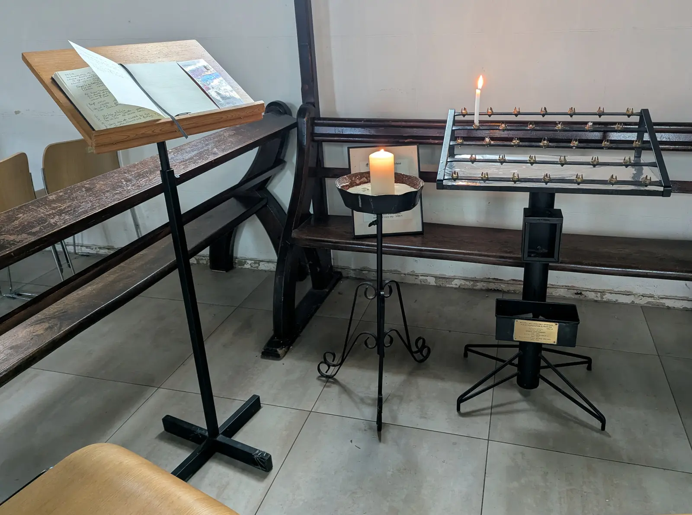{#fig-burghfield-29 fig-alt="A wooden lectern holding an open book, beside a lit candle in a holder and an iron votive candle stand, in a corner by the pews."}

{#fig-burghfield-30 fig-alt="A faded colour photograph of a children's church choir in white robes, holding red hymn books, gathered in front of an arched stone porch, with a clergyman and a woman standing at the back."}

{#fig-burghfield-31 fig-alt="A wide green field with a margin of fallen leaves in the foreground, framed by an oak branch, with trees on the horizon under a grey and white sky."}

{#fig-burghfield-32 fig-alt="A flat field of young green crops with a telegraph pole and wires, a line of trees and distant buildings on the horizon, under a cloudy sky."}

{#fig-burghfield-33 fig-alt="A two-lane road with a narrow pavement on the right climbs gently between tall autumn trees, past a sign reading Burghfield Common."}

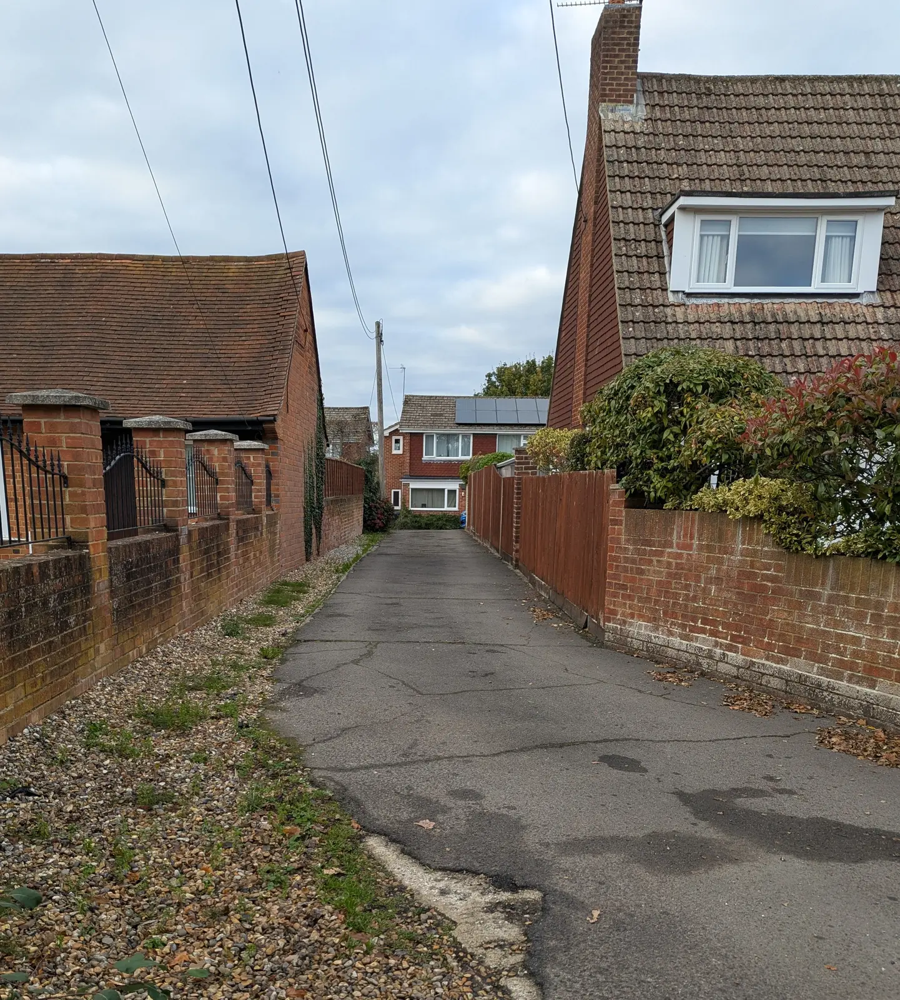{#fig-burghfield-34 fig-alt="A narrow tarmac drive running between a red-brick wall with railings and a fence, towards a modern brick house at the end, with a tile-hung house on the right."}

{#fig-burghfield-35 fig-alt="A faded, red-tinted photograph of a smiling woman in a striped top and a man in a clerical collar sitting together on a white garden bench."}

{#fig-burghfield-36 fig-alt="A faded colour photograph of a smiling woman in a cream blouse and red tartan skirt crouching on a lawn with a curly-haired toddler in red on her knee, in front of a brick house."}

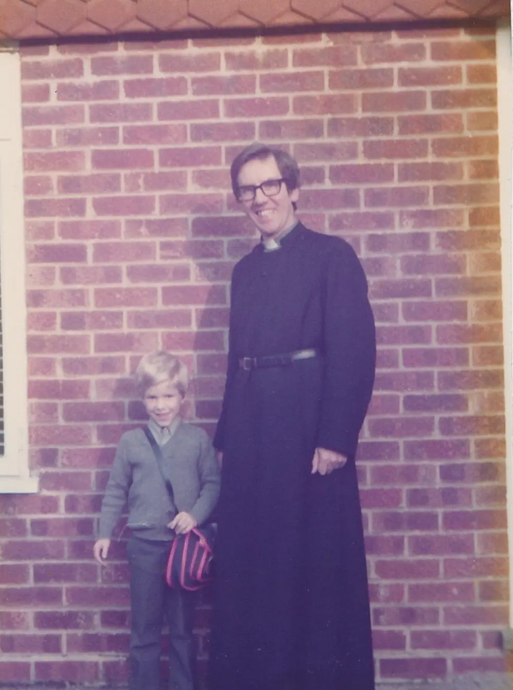{#fig-burghfield-37 fig-alt="A faded colour photograph of a small boy in a grey jumper holding a bag, standing against a brick wall beside a tall man with glasses wearing a black cassock and belt."}

{#fig-burghfield-38 fig-alt="A leaf-covered path leads into woodland of slender trees in yellow and green, with brown bracken on the right."}

{#fig-burghfield-39 fig-alt="Looking up into the canopy of a tree with dense golden-yellow leaves and dark branches, with patches of pale sky showing through."}

{#fig-burghfield-40 fig-alt="Tall, straight pine trunks rise above a dense layer of rust-brown bracken, with birch trees in yellow leaf among them."}

{#fig-burghfield-41 fig-alt="A red, horse-shaped bench seat with a black horse's head and five black seats, in a playground with green railings and autumn trees behind."}

{#fig-burghfield-42 fig-alt="A green field beside a stream under a dramatic sky of grey and white cloud, with the low sun breaking through and a church spire on the horizon."}
